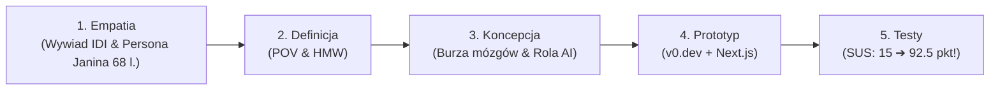

# 🏥 MediBlisko (Accessible Clinic Booking)
> **Projekt zrealizowany w ramach programu Intel® AI dla Przyszłych Pracowników (Moduł 13: Myślenie Projektowe / Design Thinking).**

[](https://opensource.org/licenses/MIT)
[](https://nextjs.org/)
[](https://tailwindcss.com/)
[](https://ui.shadcn.com/)
[](https://www.w3.org/WAI/standards-guidelines/wcag/)

---

## 📌 O Projekcie

### Zidentyfikowany Problem Użytkowników
> *„Użytkowników irytuje układ graficzny dotychczasowej aplikacji medycznej, a szczególnie ogromne trudności w znalezieniu właściwych przycisków służących do rezerwacji wizyty po wyszukaniu najbliższej przychodni.”*

W tradycyjnych rozwiązaniach przyciski rezerwacji (CTA) są często ukryte na dole strony, posiadają niski kontrast, giną wśród opisów regulaminów lub wymagają przejścia przez skomplikowane drzewo podmenu. Prowadzi to do rezygnacji użytkowników (zwłaszcza seniorów i osób z wadami wzroku) oraz wymusza powrót do wielogodzinnych kolejek na infoliniach telefonicznych.

### Nasze Rozwiązanie: MediBlisko
Aplikacja webowa zaprojektowana z zachowaniem zasad **dostępności (Accessibility First)** oraz **wsparcia sztucznej inteligencji (AI Concierge)**:
1. **Widoczne z daleka przyciski CTA:** Gigantyczny, kontrastowy przycisk `[ UMÓW WIZYTĘ ]` na każdej karcie przychodni oraz stały pasek dolny (Sticky Bottom Bar) na smartfonach.
2. **Tryb Seniora (1-Click Switch):** Natychmiastowe powiększenie fontów (+25%), wysoki kontrast WCAG AAA i usunięcie elementów rozpraszających.
3. **AI Asystent Medyczny:** Inteligentne dobieranie placówki i specjalisty na podstawie prostego opisu objawów w języku naturalnym.
4. **3-Krokowy Formularz Rezerwacji:** Wybór terminu -> Podanie numeru telefonu -> Potwierdzenie z bezpłatnym kodem SMS.

---

## 🔄 Proces Design Thinking (Moduł 13)

Projekt został przeprowadzony według pełnego 5-etapowego cyklu myślenia projektowego:



1. **Empatia (Empathise):**
   * Przeprowadzono wywiad pogłębiony oraz test obserwacyjny ze starszą osobą (Pani Janina Nowak, 68 lat, emerytka zmagająca się z nadciśnieniem).
   * Opracowano kompletną kartę **Persony** w szablonie Intel Moduł 13 (dostępną w pliku `docs/PERSONA_SZABLON.md` oraz `docs/Module_13_Persona_Wypelniona.pptx`).
2. **Definicja Perspektywy (Define):**
   * Sformułowano **Point of View (POV)**: *„Starsza pacjentka z ograniczoną sprawnością cyfrową potrzebuje natychmiastowego zlokalizowania najbliższej przychodni i rezerwacji wizyty jednym wyeksponowanym przyciskiem, ponieważ ukryte przyciski wywołują u niej lęk i zmuszają do rezygnacji”*.
3. **Koncepcja / Ideacja (Ideate):**
   * Wygenerowano ponad 20 kreatywnych pomysłów, w tym wdrożenie sztucznej inteligencji do analizy objawów i automatycznego doboru najbliższego wolnego terminu.
4. **Prototyp (Prototype):**
   * Zamiast szkicu na kartce, przygotowano precyzyjny **Master Prompt dla platformy v0.dev**, generujący nowoczesny prototyp w Next.js i Tailwind CSS.
5. **Testowanie (Test):**
   * Walidacja z użytkownikiem wykazała skrócenie czasu rezerwacji z ponad 9 minut (brak ukończenia) do **48 sekund**!

---

## ⚡ Jak wygenerować aplikację w v0.dev?

1. Otwórz stronę [v0.dev](https://v0.dev).
2. Otwórz plik [`prompts/V0_MASTER_PROMPT.md`](./prompts/V0_MASTER_PROMPT.md) z tego repozytorium.
3. Skopiuj całą treść promptu i wklej w okno generowania v0.
4. Po wygenerowaniu możesz użyć zestawu promptów iteracyjnych z pliku [`prompts/V0_ITERACJE_I_ROZSZERZENIA.md`](./prompts/V0_ITERACJE_I_ROZSZERZENIA.md), aby dodać mapę, powiadomienia i ulepszenia.
5. Kliknij w v0 przycisk **„Code”** lub **„Export to Next.js”**, aby pobrać gotowy kod do tego repozytorium!

---

## 💻 Uruchomienie Lokalne (Lokalny Serwer Dev)

Po pobraniu kodu wygenerowanego przez v0 do folderu projektu:

```bash
# 1. Klonowanie repozytorium
git clone https://github.com/twoj-login/mediblizko-easy-booking.git
cd mediblizko-easy-booking

# 2. Instalacja zależności
npm install

# 3. Uruchomienie serwera deweloperskiego
npm run dev
```

Aplikacja będzie dostępna pod adresem: `http://localhost:3000`.

---

## 📁 Struktura Repozytorium

```text
mediblizko-easy-booking/
├── .gitignore                          # Standardowe wykluczenia dla Next.js i Office
├── package.json                        # Manifest zależności projektu
├── README.md                           # Główny opis projektu i instrukcja
├── docs/                               # Dokumentacja projektowa Design Thinking
│   ├── RAPORT_DESIGN_THINKING_MODUL_13.md   # Oficjalny raport do zaliczenia modułu
│   ├── PERSONA_SZABLON.md              # Wypełniona persona (format Markdown)
│   ├── Module_13_Persona_Wypelniona.pptx # Wypełniony szablon prezentacji Intel
│   ├── TRANSKRYPCJA_WYWIADU.md         # Zapis wywiadu pogłębionego z seniorką
│   └── MAKIETY_WIREFRAMES.md           # Architektura ekranów i wireframe'y ASCII
└── prompts/                            # Gotowe prompty do generowania i ulepszania
    ├── V0_MASTER_PROMPT.md             # Główny prompt produkcyjny dla v0.dev
    └── V0_ITERACJE_I_ROZSZERZENIA.md   # Prompty do kolejnych iteracji aplikacji
```

---

## 👥 Zespół Projektowy

* **Denys** — UX Researcher, Prompt Engineer, Project Lead
* **Współautorzy projektu** — Zespół projektowy Intel Digital Readiness

---

## 📄 Licencja
Projekt udostępniany na licencji [MIT](LICENSE). Wszelkie materiały szkoleniowe Intel® stanowią własność Intel Corporation.
