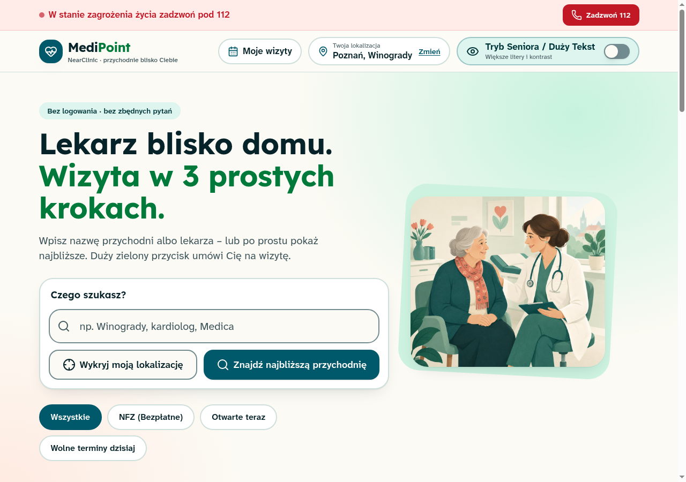
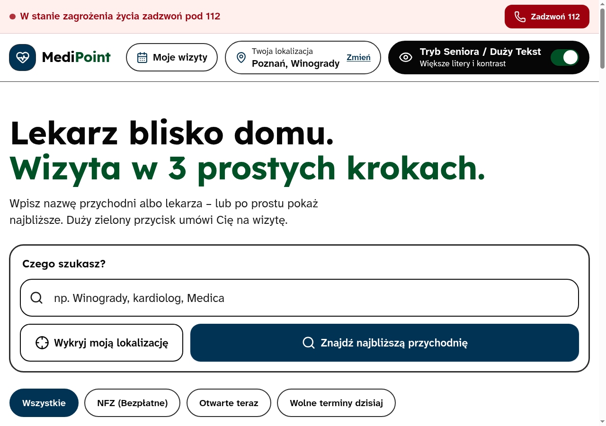
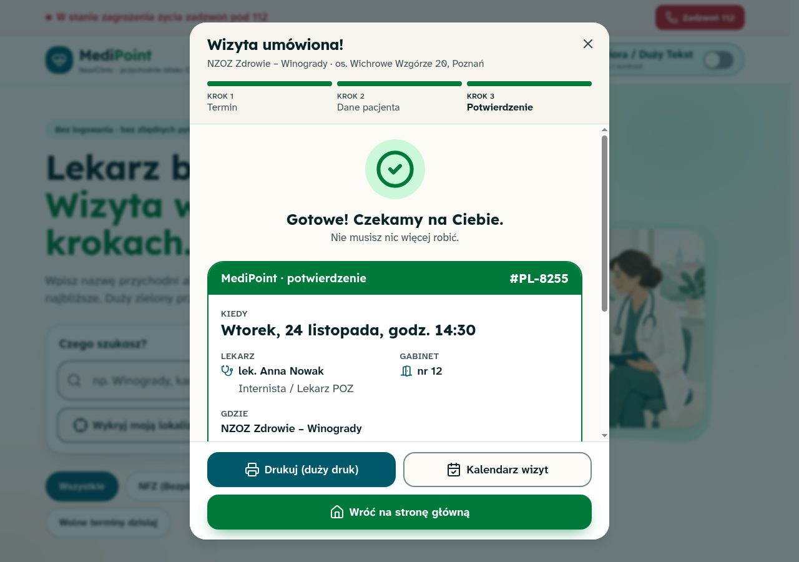
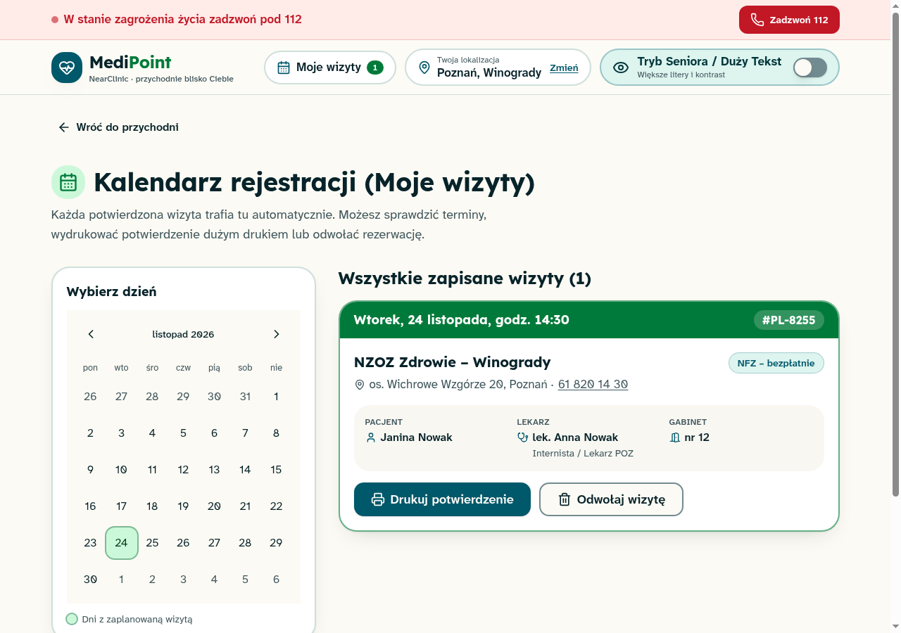

# MediPoint – Wyszukiwarka przychodni i rezerwacja wizyt

Aplikacja webowa do szybkiego wyszukiwania najbliższych przychodni w Poznaniu oraz rezerwacji wizyt lekarskich w 3 krokach, zaprojektowana z myślą o czytelności i dostępności (w tym dla seniorów).

---

## Zrzuty ekranu

### Strona główna i wyszukiwarka przychodni


### Tryb Seniora / Duży Tekst


### Potwierdzenie rezerwacji wizyty (Krok 3)


### Kalendarz rejestracji klienta („Moje wizyty”)


---

## Główne funkcje

- **Wyszukiwarka i filtry przychodni:** wyszukiwanie po nazwie, dzielnicy lub specjalizacji w Poznaniu (*Winogrady*, *Piątkowo*, *Jeżyce*, *Stare Miasto*, *Rataje*), obsługa lokalizacji GPS (Geolocation API) oraz szybkie filtry (*Wszystkie*, *NFZ (Bezpłatne)*, *Otwarte teraz*, *Wolne terminy dzisiaj*).
- **Lista i mapa przychodni:** przełącznik widoku `Lista` / `Mapa` oraz podstrona szczegółów przychodni (`/przychodnia/$clinicId`) z listą lekarzy, gabinetów i najbliższych wolnych terminów.
- **Asystent MediPoint:** formularz opisu objawów oraz gotowe przykłady dolegliwości, które podpowiadają odpowiednią specjalizację lekarza, filtrują pasujące przychodnie i ostrzegają przed stanami nagłymi (przycisk `112`).
- **Tryb Seniora / Duży Tekst:** przełącznik w nagłówku zwiększający rozmiar czcionki (+25%), podnoszący kontrast kolorów i upraszczający widok.
- **3-krokowa rezerwacja wizyty:** wybór dnia i godziny (`Termin`), podanie danych pacjenta (`Dane pacjenta`), a następnie ekran potwierdzenia z numerem biletu (`#PL-xxxx`) oraz opcją wydruku dużym drukiem (PDF).
- **Kalendarz rejestracji („Moje wizyty”):** każda potwierdzona wizyta automatycznie zapisuje się w kalendarzu użytkownika w przeglądarce (`localStorage`), z podglądem dni w kalendarzu, wydrukiem potwierdzenia i możliwością odwołania wizyty.
- **Baner alarmowy 112:** stały przycisk połączenia alarmowego w górnej części strony.

---

## Technologie

- **Framework:** TanStack Start + TanStack Router + React 19
- **Budowanie:** Vite 8 + TypeScript
- **Style i komponenty:** Tailwind CSS v4 + shadcn/ui (Radix UI) + Lucide Icons
- **Testy:** Vitest + Testing Library

---

## Uruchomienie lokalne

```bash
# 1. Klonowanie repozytorium
git clone https://github.com/ShapDenys/medipoint-app.git
cd medipoint-app

# 2. Instalacja zależności
npm install

# 3. Uruchomienie serwera deweloperskiego
npm run dev
```

Aplikacja będzie dostępna pod adresem `http://localhost:3000`.

### Dodatkowe komendy

```bash
npm test       # Uruchomienie testów jednostkowych (Vitest)
npm run build  # Budowanie wersji produkcyjnej
```
