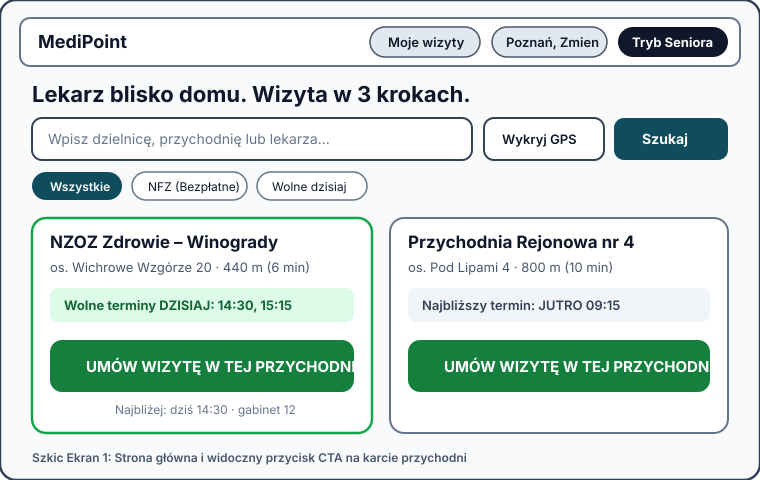
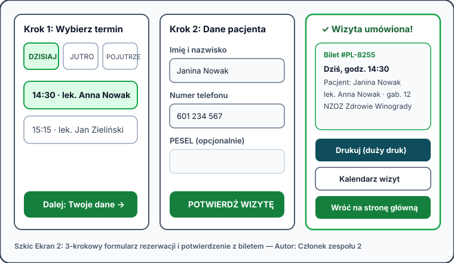
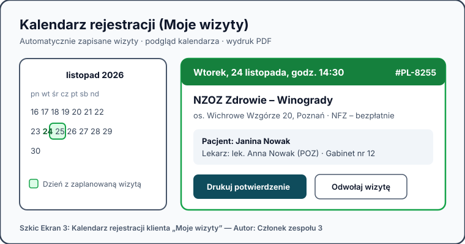
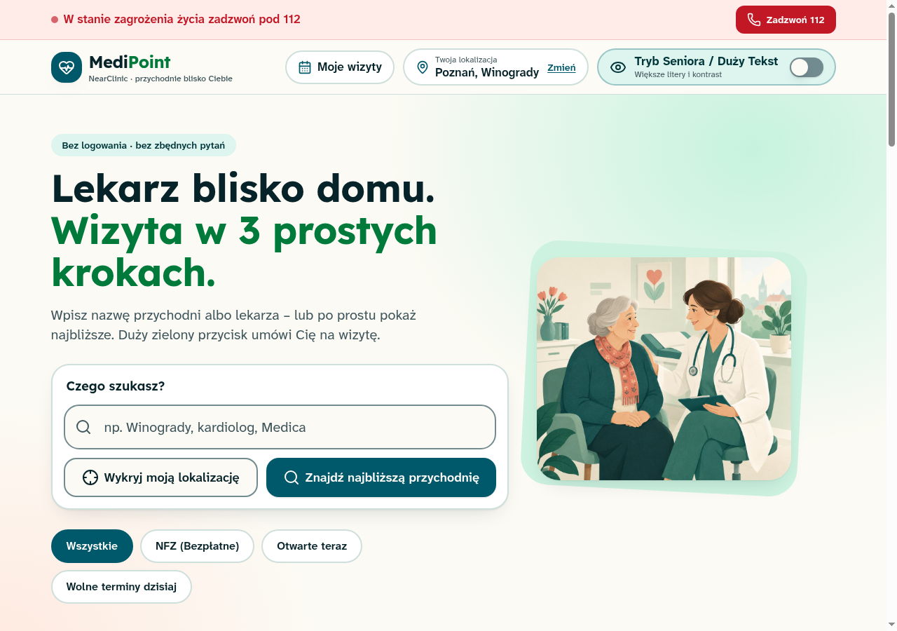
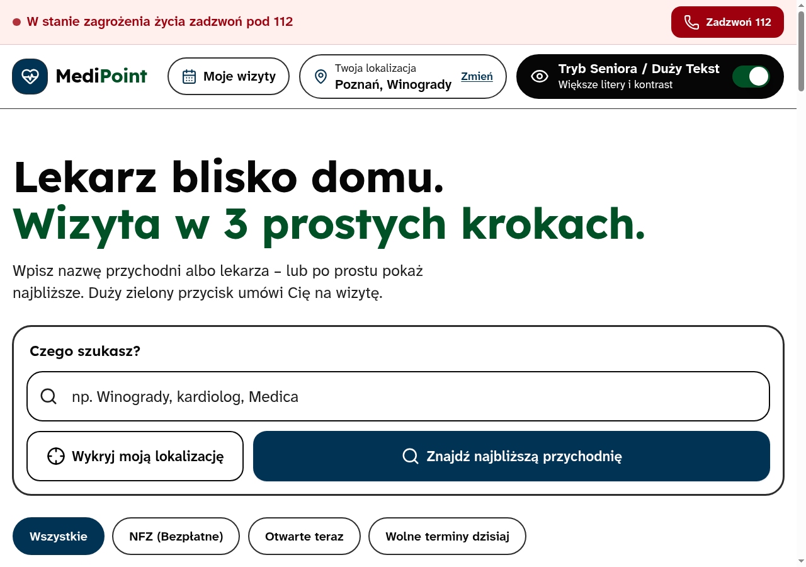
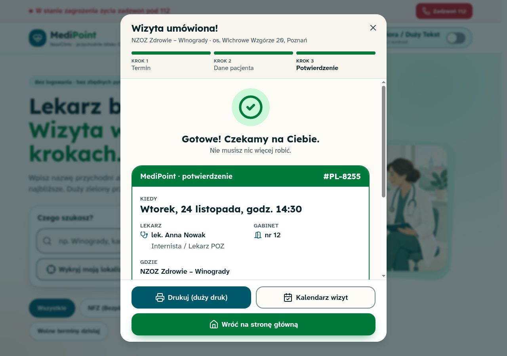
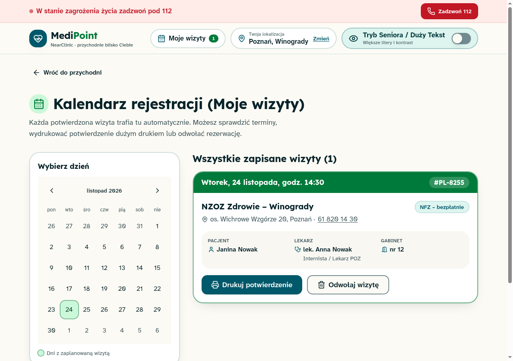

# Raport z Projektu: Myślenie Projektowe (Design Thinking) – Moduł 13
**Intel® AI dla Przyszłych Pracowników**

---

## Metryka Projektu

* **Temat zadania:** Usprawnienie aplikacji do wyszukiwania najbliższej przychodni oraz rezerwacji wizyty lekarskiej.
* **Zidentyfikowany problem:** Użytkowników irytuje układ graficzny aplikacji, a szczególnie trudności w znalezieniu właściwych przycisków służących do rezerwacji wizyty.
* **Członkowie zespołu projektowego:**
  1. **Denys** — ............................................................
  2. **Członek Zespołu 2** — ............................................................
  3. **Członek Zespołu 3** — ............................................................
* **Data sporządzenia raportu:** 24 listopada 2026 r.

---

## 1. Faza Empatii (Empathise)

### 1.1. Wywiad i obserwacje
W celu poznania potrzeb użytkowników oraz zrozumienia, dlaczego obecny interfejs powoduje frustrację, przeprowadzono rozmowę oraz obserwację korzystania z aplikacji przez osobę starszą (lub wczucie się w jej perspektywę podczas korzystania z typowej aplikacji medycznej):

* **Rozmówca (Persona):** Pani Janina Nowak (68 lat, emerytowana nauczycielka z Poznania, lecząca się na nadciśnienie tętnicze).
* **Sytuacja testowa:** Znalezienie najbliższej przychodni i umówienie wizyty u lekarza POZ.
* **Najważniejsze obserwacje:**
  * Użytkowniczka potrafi wpisać nazwę dzielnicy i otworzyć listę przychodni, ale po przejściu dalej nie widzi wyraźnego przycisku do rezerwacji.
  * Przyciski rezerwacji są zbyt małe, mało kontrastowe i gubią się wśród innych informacji (opisów, adresów, regulaminów).
  * Brak jasnego komunikatu powoduje stres, obawę przed popełnieniem błędu i rezygnację z aplikacji na rzecz długiego oczekiwania na połączenie telefoniczne z rejestracją.
* **Cytat z wywiadu:**
  > *„Chcę od razu widzieć duży, wyraźny przycisk »Umów wizytę« i mieć pewność, że termin jest potwierdzony, a nie błądzić po małych ikonkach i bać się, że coś zepsuję!”*

### 1.2. Podsumowanie Persony
Szczegółowa karta Persony została uzupełniona w oficjalnym szablonie prezentacji oraz w dokumencie tekstowym:
* **Plik prezentacji:** [`docs/Module_13_Persona_Wypelniona.pptx`](./Module_13_Persona_Wypelniona.pptx)
* **Wersja tekstowa:** [`docs/PERSONA_SZABLON.md`](./PERSONA_SZABLON.md)
* **Zapis wywiadu:** [`docs/TRANSKRYPCJA_WYWIADU.md`](./TRANSKRYPCJA_WYWIADU.md)

---

## 2. Faza Definicji Perspektywy (Define)

Na podstawie zebranych informacji z fazy empatii sformułowano zwięzłą definicję perspektywy (**Point of View – POV**):

> **Starsza pacjentka z podstawową znajomością smartfona i słabszym wzrokiem potrzebuje szybko znaleźć najbliższą przychodnię oraz umówić wizytę jednym dużym, wyraźnym przyciskiem, ponieważ ukryte i mało kontrastowe elementy obecnej aplikacji wywołują u niej frustrację i zmuszają ją do powrotu do trudnego kontaktu telefonicznego.**

### Kluczowe wnioski:
1. Przycisk rezerwacji musi być głównym, najbardziej widocznym elementem na każdej karcie przychodni.
2. Interfejs powinien oferować tryb zwiększonej czytelności (większy tekst, wyższy kontrast) bez zbędnych elementów rozpraszających.
3. Proces rezerwacji powinien być krótki (maksymalnie 3 proste kroki) i kończyć się czytelnym potwierdzeniem oraz zapisaniem wizyty w kalendarzu.

---

## 3. Faza Koncepcji / Burza Mózgów (Ideate)

Podczas burzy mózgów zebrano hasłowo różne pomysły na rozwiązanie problemu (zarówno proste usprawnienia, jak i bardziej zaawansowane koncepcje):

* Wielki, kontrastowy przycisk **„UMÓW WIZYTĘ W TEJ PRZYCHODNI”** bezpośrednio na każdej karcie przychodni.
* Stały pasek rezerwacji u dołu ekranu na telefonach (**Sticky Bar**), żeby przycisk nigdy nie znikał podczas przewijania.
* **Tryb Seniora / Duży Tekst** włączany jednym kliknięciem w nagłówku (większe litery, wysoki kontrast, uproszczony widok).
* **Asystent objawów (AI / dopasowanie lekarza):** użytkownik wpisuje własnymi słowami, co mu dolega, a aplikacja podpowiada właściwą specjalizację i filtruje przychodnie (z wykrywaniem stanów nagłych i przyciskiem 112).
* Jednoekranowe filtry: *„Wolne terminy dzisiaj”*, *„NFZ (Bezpłatne)”*, *„Otwarte teraz”*.
* Wykrywanie lokalizacji **GPS** jednym kliknięciem oraz wybór dzielnicy z listy.
* Rezerwacja podzielona na **3 proste kroki**: wybór terminu → dane pacjenta → potwierdzenie.
* **Automatyczny kalendarz wizyt („Moje wizyty”)** w aplikacji, żeby pacjent nie musiał pobierać osobnych plików kalendarza.
* Czytelny **wydruk potwierdzenia dużym drukiem (PDF)** z wyraźnym imieniem pacjenta, adresem i godziną.
* *(Pomysł wybiegający w przyszłość)* Fizyczny przycisk IoT w domu seniora do zamawiania wizyty u stałego lekarza lub pełna obsługa głosowa.

---

## 4. Faza Prototypu (Prototype)

### 4.1. Wstępne szkice ekranów (etap koncepcyjny)
Każdy członek zespołu przygotował wstępny szkic ekranów rozwiązujących zidentyfikowane problemy:

1. **Ekran 1 – Strona główna i karta przychodni z widocznym przyciskiem CTA** *(Autor: Denys)*  
   

2. **Ekran 2 – 3-krokowy formularz rezerwacji i potwierdzenie** *(Autor: Członek zespołu 2)*  
   

3. **Ekran 3 – Kalendarz rejestracji klienta („Moje wizyty”)** *(Autor: Członek zespołu 3)*  
   

### 4.2. Finalne rozwiązanie – działająca aplikacja MediPoint
Po wymianie opinii w zespole połączono wszystkie elementy w jedną spójną aplikację webową **MediPoint** (zbudowaną w TanStack Start, React, Vite, Tailwind CSS i shadcn/ui):

* **Ekran główny:** wyszukiwarka przychodni, wybór dzielnicy lub GPS, szybkie filtry, Asystent MediPoint oraz lista/mapa przychodni z dużym zielonym przyciskiem `UMÓW WIZYTĘ W TEJ PRZYCHODNI`.  
  

* **Tryb Seniora / Duży Tekst:** przełącznik w nagłówku zwiększający czcionkę o 25%, podnoszący kontrast i ukrywający zbędne elementy.  
  

* **3-krokowa rezerwacja i potwierdzenie:** wybór dnia i godziny, dane pacjenta, a następnie czytelne potwierdzenie z biletem `#PL-xxxx` i wydrukiem dużym drukiem (PDF).  
  

* **Kalendarz rejestracji („Moje wizyty”):** każda potwierdzona wizyta trafia automatycznie do kalendarza w aplikacji, gdzie można ją obejrzeć, wydrukować lub odwołać.  
  

---

## 5. Podsumowanie

Przejście przez wszystkie etapy myślenia projektowego pozwoliło skupić się na najważniejszym problemie użytkowników: braku widocznych i jednoznacznych przycisków rezerwacji. W efekcie powstała aplikacja **MediPoint**, która zamiast przeładowanego interfejsu oferuje czytelne przyciski CTA, Tryb Seniora, asystenta doboru lekarza, 3-krokowy proces rezerwacji, czytelny wydruk potwierdzenia oraz automatyczny kalendarz wizyt.

### Podpisy członków grupy:

1. Denys ............................................................................ (Data: ......................)
2. .................................................................................... (Data: ......................)
3. .................................................................................... (Data: ......................)
